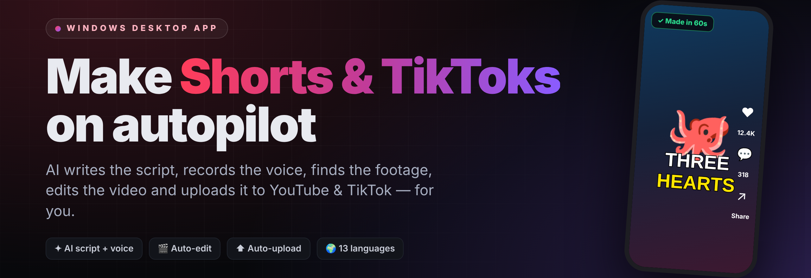
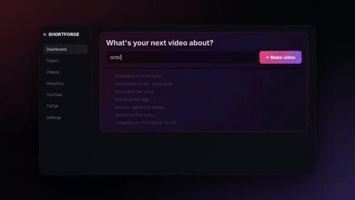
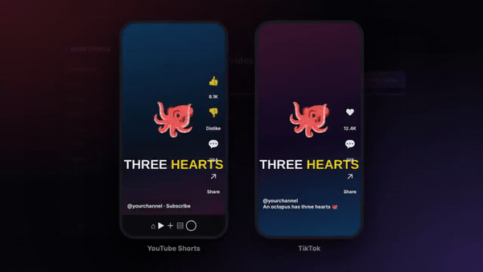

# ShortForge Studio

**Make YouTube Shorts, TikToks & Reels on autopilot.**
A Windows desktop app that writes, voices, edits and uploads short videos for your channel — powered by AI.

[**⬇ Download for Windows**](../../releases/latest) · [Website](https://dovlamc-spec.github.io/shortforge-updates/) · [Pricing](https://dovlamc-spec.github.io/shortforge-updates/#pricing) · [Privacy](https://dovlamc-spec.github.io/shortforge-updates/privacy.html) · [Terms](https://dovlamc-spec.github.io/shortforge-updates/terms.html)

---

## ✨ What it does

You type a subject. ShortForge does the rest — a full vertical video in about a minute:

1. **Writes the script** with a strong hook, then an AI editor rewrites it until it scores 8+/10
2. **Records the voiceover** in a natural neural voice
3. **Finds matching footage** and photos that change with every sentence
4. **Edits the video** — animated captions, emojis, music, your logo
5. **Uploads it** straight to your YouTube and TikTok, on a schedule you pick

### Type a subject → get a finished video

### Posts straight to YouTube & TikTok

---

## 🎬 Everything inside

### ✍️ AI scripts
- Strong hooks that stop the scroll ("Most people don't know…")
- A second AI acts as editor and rewrites until the script scores 8+/10
- Verified facts only — no made-up nonsense
- Auto title, description and hashtags

### 🎙️ Voice
- Natural neural voices
- **13 languages** — English, Spanish, Portuguese, German, French, Italian, Dutch, Polish, Turkish, Indonesian, Serbian, Croatian, Romanian
- Make one topic in several languages at once

### 🎞️ Video & editing
- Background footage **and photos that change with every sentence**
- **5 animated caption styles:** Classic, Bold pop, Clean, Neon, Karaoke
- Ken Burns zoom on photos, music, your own logo
- SRT subtitles and thumbnails
- **Fast GPU rendering** — auto-detects NVIDIA, AMD and Intel graphics

### 📤 Publishing
- **YouTube** — auto-upload and schedule to your channel at your best times
- **TikTok** — send as a draft or post directly
- **Instagram Reels** — every video is Reels-ready to share in two clicks
- Posting calendar and best-time suggestions

### 📊 Analytics
- Views, likes, like-rate and videos per day
- Best style and best time to post, pulled from your own videos
- Top 5 videos and a **"What next?"** panel with tips

### 💬 Community
- Live **chat** with other creators — emoji, images, drag & drop
- A **forum** with categories, replies and search
- Owner & staff moderation tools

### ⚙️ Pro tools
- **Make 1–10 videos at once** from a topic queue (AI idea generator included)
- **Multiple channels** — each keeps its own niche, settings, videos and accounts
- Premium license keys, auto-updates with patch notes

---

## 💳 Plans

Start free with **3 videos a day**. Upgrade for unlimited videos, no watermark and auto-upload:

| Plan | What you get |
| --- | --- |
| **TikTok** | Unlimited videos + auto-post to TikTok |
| **YouTube** | Unlimited videos + auto-upload to YouTube |
| **Pack** ⭐ | Everything, on **both** platforms |

See live prices on the [**pricing page**](https://dovlamc-spec.github.io/shortforge-updates/#pricing).

---

## 🚀 Install

1. Download **ShortForgeStudio-Setup.exe** from the [latest release](../../releases/latest)
2. Run it and create an account in the app
3. Follow the setup wizard (free Groq and Pixabay keys — the app shows you where to get them)

> Windows may show *"Unknown publisher"* on first run — that's normal for a new app. Click **More info → Run anyway**.

**Requirements:** Windows 10/11 · an internet connection · a free [Groq](https://console.groq.com) key (AI) and [Pixabay](https://pixabay.com/api/docs/) key (footage). A dedicated GPU is optional but renders faster.

---

© 2026 Wadisha · This repository contains only the releases and the website — not the source code.

